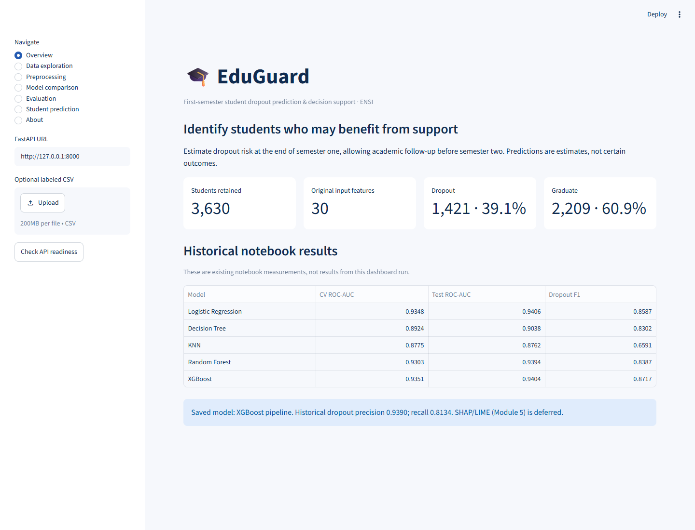
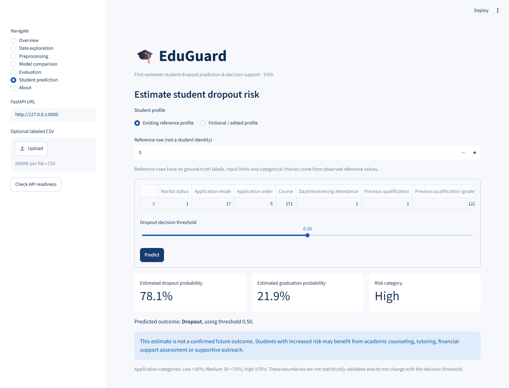

# EduGuard

Predict student dropout risk at the end of the first semester.

**3,630 students · 30 first-semester features · Saved XGBoost model.**

## Run locally

Install Python 3.12 or 3.13, then run once in the project folder:

```powershell
python -m venv .venv
.\.venv\Scripts\python.exe -m pip install -r requirements.txt
```

Double-click **start_eduguard.bat**, then open [localhost:8501](http://localhost:8501).

Test without writing code: **Check API readiness → Student prediction → select a profile → Predict**. No retraining is needed.

API documentation: [localhost:8000/docs](http://localhost:8000/docs). Use **Try it out** to test a prediction in the browser.

## Project

`app.py` (Streamlit), `api.py` (FastAPI), and `ml_utils.py` (training/evaluation). The saved model uses `preprocessing.pkl` + `xgboost_model.json`; `reference.csv` supplies example profiles.

Deliverables: original `prj1-datamining.ipynb`, [one-page report](ONE_PAGER.pdf), and screenshots below.

Training data loads from [UCI](https://archive.ics.uci.edu/dataset/697/predict+students+dropout+and+academic+success), or upload a labeled CSV. Enrolled students and second-semester variables are excluded; Dropout=0, Graduate=1.

Optional training compares five classifiers. Choose thresholds on validation data before checking the held-out test.

Saved XGBoost results from the notebook: **ROC-AUC .9404 · Dropout F1 .8717 · Precision .9390 · Recall .8134**.

Use predictions to support student follow-up. Risk bands: Low <30%, Medium 30–<70%, High ≥70%.

## Explain a prediction

Update an existing environment with `.\.venv\Scripts\python.exe -m pip install -r requirements.txt`, then restart the launcher.

- **Explainability → Compute global explanations:** model importance, permutation importance, SHAP beeswarm and dependence plots. Also supports models trained in the dashboard.
- **Student prediction → Explain with SHAP and LIME → Predict:** waterfall, LIME comparison and a short explanation. Trained models also offer held-out row explanations.
- FastAPI: **POST /explain** (one student), **POST /explain/global** (2–200 rows; optional 0/1 labels for permutation importance). Try both in `/docs`.

`xai.py` uses exact [XGBoost TreeSHAP](https://xgboost.readthedocs.io/en/stable/python/python_api.html#xgboost.Booster.predict), independent-feature linear SHAP for logistic regression, and NumPy Shapley sampling for other classifiers (8 paired orders, up to 8 training background rows). Only [LIME](https://lime-ml.readthedocs.io/en/latest/lime.html#module-lime.lime_tabular) adds a dependency; no separate SHAP/Numba installation is needed. All explanations concern class 0. Compare SHAP/LIME directions and rankings, not magnitudes; check LIME fit quality. Sampling can be noisy, cohort importance may include training rows, and explanations are not causal or proof of fairness.

## Screenshots





## Test and deploy

Tests: `.\.venv\Scripts\python.exe -m pytest -q`.

Deploy FastAPI on a backend server and Streamlit on Community Cloud. Set **EDUGUARD_API_URL** to the backend's HTTPS URL. Online deployment is pending.
